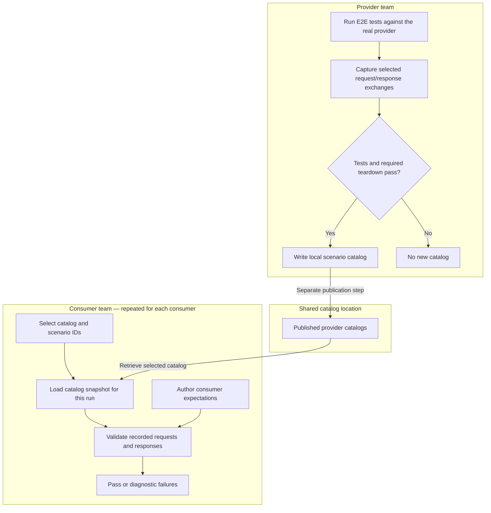
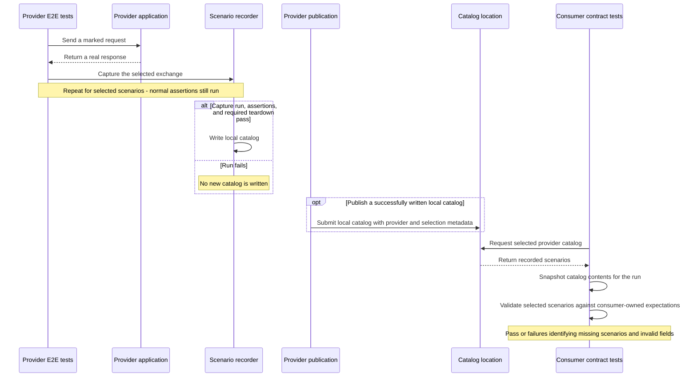
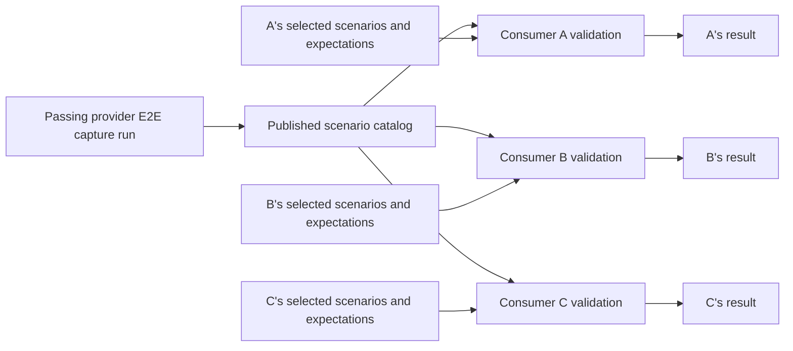

# RFC: Provider-derived catalogs for consumer contract verification

Status: proposed approach for architectural review.

## 1. Proposal

Consumer teams need to know whether an API still meets their expectations. Locally
maintained examples can drift from provider behavior, while tests against a live
provider require an available service and controlled data.

This proposal connects three activities: providers capture examples from passing
E2E tests, publish them to a central location, and consumers check the published
examples against their own contracts. A provider can supply the same catalog to
many consumers, each with different expectations.

The question for review is whether this is a useful way to communicate tested
provider behavior and detect changes that matter to consumers. This RFC describes
the approach and its limits.

Three terms describe the data and checks:

- A **scenario** is a concrete request and response captured from a passing provider
  test, identified by a stable ID such as `pet.create.success`.
- A **catalog** is a collection of scenarios published for a provider.
- A **consumer contract** is the consumer's set of expectations for selected
  scenarios, expressed here as runtime Zod schemas and ordinary tests.

The Petstore prototype illustrates this pattern with Vitest, Supertest, a catalog
API, and a reusable contract-testing package. Those tools demonstrate the approach;
the general pattern does not depend on that particular stack.

## 2. How it works



Providers publish examples of tested behavior. Each consumer independently checks
those examples against its own requirements.

### Capture: the provider records tested examples

Provider authors mark the requests that should become scenarios and keep their
normal assertions. This shortened example uses the existing Petstore fixture,
which runs a real application with an isolated database:

```ts
import { it } from 'vitest';
import { capture } from '@response-capture/scenario-recorder/supertest';
import { pet, usePetstoreFixture } from './support/petstore-fixture.js';

const { api } = usePetstoreFixture();

it('creates a pet with defaults', async () => {
  await api()
    .post('/pet')
    .send(pet)
    .use(capture('pet.create.success'))
    .expect(201)
    .expect({ ...pet, id: 1, tags: [], status: 'available' });
});
```

The marker records the exchange; the provider test still checks real behavior.
Only selected requests are captured, so setup traffic stays out of the catalog.
Expected error responses can also be useful examples: a test that successfully
checks a `404` can contribute that scenario.

A dedicated capture configuration writes the catalog only after the selected
capture run, its assertions, and required teardown pass. Receiving a response is
not enough to make a recording eligible. Scenario IDs must be unique within the
catalog. Ordinary provider test runs leave capture markers inactive.

A catalog contains records like this shortened `pet.create.success` example:

```json
{
  "catalogVersion": 1,
  "scenarios": [
    {
      "schemaVersion": 1,
      "id": "pet.create.success",
      "request": {
        "method": "POST",
        "path": "/pet",
        "body": { "name": "Milo", "photoUrls": ["https://example.com/milo.jpg"] }
      },
      "response": {
        "status": 201,
        "body": {
          "id": 1,
          "name": "Milo",
          "photoUrls": ["https://example.com/milo.jpg"],
          "tags": [],
          "status": "available"
        }
      }
    }
  ]
}
```

The current format supports JSON bodies and decoded query parameters. For example,
a filter request records `path: '/pet/findByStatus'` and
`query: { status: ['available'] }`. Query values are arrays so repeated parameters
can retain their order. Bodyless exchanges use `null`.

### Publish: catalogs become available to consumers

Capture and submission are separate steps. The provider can produce a local
catalog without a running catalog service; a failed upload can be retried using
that file.

With workspace dependencies installed, the prototype's commands run from the
repository root:

```sh
npm run scenarios:capture
# With the catalog API running, publish under the main alias.
CATALOG_ALIAS=main npm run scenarios:submit
```

For local use, start the catalog API in another terminal with
`npm run dev --workspace=catalog-api`. The submission sends the captured catalog,
provider identity (`petstore-api`), a Git commit label, and an optional alias to
`PUT /catalog-submissions`.

Consumers retrieve the latest submitted catalog with
`GET /catalogs/petstore-api`, or select an alias or commit with
`GET /catalogs/petstore-api/main`. Here, “latest” means latest submission. A missing
catalog returns `404`.

The central location gives teams a shared place to publish, discover, and inspect
provider examples. The prototype's catalog browser helps authors find stable IDs
and examine exchanges. An artifact repository could serve the same distribution
role; the continuously running catalog API is one implementation choice.

### Verify: consumers check their own expectations

The consumer chooses its catalog source in Vitest global setup:

```ts
import { fileURLToPath } from 'node:url';
import { contractGlobalSetup } from '@response-capture/scenario-contract/vitest';

export default contractGlobalSetup({
  rootDirectory: fileURLToPath(new URL('../', import.meta.url)),
  outputDirectory: 'test-results/contract',
  catalogs: {
    pets: {
      systemName: 'petstore-api',
      catalogApiUrl: 'http://localhost:3001',
      selection: { latest: true },
    },
  },
});
```

`pets` is a local alias; `petstore-api` identifies the published provider. The
consumer can instead select a particular alias or commit, or read a raw catalog
file. Each distinct source loads once per run, and workers receive the same
catalog contents. Saved snapshots and their digests identify the payload used by
that run. Loading errors fail the run without fallback.

The consumer then declares what it needs from `pet.create.success`. These schemas
are authored independently of provider DTOs and shared application types:

```ts
import { it } from 'vitest';
import { z } from 'zod';
import { assertScenarioContract } from '@response-capture/scenario-contract';
import { getContractCatalog } from '@response-capture/scenario-contract/vitest';

const catalog = getContractCatalog('pets');
const petInput = z.looseObject({ name: z.string(), photoUrls: z.array(z.string()) });
const savedPet = petInput.extend({
  id: z.int().positive(),
  status: z.enum(['available', 'pending', 'sold']),
});

it('receives a saved pet from the create operation', () => {
  assertScenarioContract(catalog, 'pet.create.success', {
    request: z.looseObject({
      method: z.literal('POST'),
      path: z.literal('/pet'),
      query: z.undefined(),
      body: petInput,
    }),
    response: z.looseObject({
      status: z.literal(201),
      body: savedPet,
    }),
  });
});
```

This focused contract requires a name, photo URLs, a positive safe integer ID, and
an allowed status. A consumer that uses category or tag fields adds those schemas
too. It can require structure without tying expectations to fixture names or IDs.

Schemas validate the complete recorded request and response objects. Consumers
can check methods, route structure, query parameters, statuses, and body fields;
fields left out of a loose object schema impose no requirement. Additional payload
fields are accepted. For an error scenario, a consumer can require the response
status without constraining an error body it does not use.

These are runtime checks. Schemas must be synchronous, and consumers should avoid
coercion, defaults, or transformations that hide incompatible data. A missing
scenario or invalid field fails its individual test with the provider, scenario
ID, catalog source, digest, and failing field path.

The existing consumer runs with `npm run test:contract` from the repository root.
The [consumer setup guide](consumer_contract_testing.md) covers configuration,
query and route examples, file input, and execution in more detail.

## 3. What passing tests establish

A passing consumer test means that its declared expectations hold for the selected
recorded example. Confidence depends on both what the provider recorded and what
the consumer chose to check.

| Layer                              | What a pass establishes                                                                                                 |
| ---------------------------------- | ----------------------------------------------------------------------------------------------------------------------- |
| Provider E2E test and capture gate | The selected real exchange came from a passing test attempt in a passing capture run; the provider assertions held.     |
| Catalog format validation          | The artifact has supported structural fields, valid JSON, and unique scenario IDs. It does not supply domain contracts. |
| Consumer contract test             | The required scenario exists and its recorded request/response satisfies the supplied consumer schemas.                 |
| Run snapshot                       | The tests use the same loaded catalog contents for that source, with a digest identifying the payload.                  |

Concrete changes make the boundary easier to see:

- Removing `pet.create.success` fails the consumer test that requires that ID.
- Changing `response.body.id` from a number to a string, removing `name`, or using
  an unknown status fails the example contract above.
- Removing a query parameter fails a filter contract that requires that key.
- Adding a response field can pass a loose object schema. Changing a pet's name
  or safe integer ID can also pass when the consumer requires its type rather
  than a particular fixture value.

These checks evaluate recorded examples. They do not execute the consumer
application or prove that every request it constructs will be accepted by the
provider. An application could serialize a request incorrectly while its catalog
contract still passes. Unrecorded inputs, state transitions, authentication, and
deployment behavior remain outside these checks. The current JSON-focused capture
format also omits request headers and most response headers.

Catalog choice matters as well. An old catalog can keep satisfying a contract
after the provider changes. The prototype records Git labels at submission time,
rather than binding them to capture time, and a new submission for the same
provider/commit pair replaces the stored catalog. Even a commit selector is
therefore not an immutable artifact identity. A snapshot digest identifies the
tested payload; it does not prove which code produced it or who published it.

The layers complement one another: provider E2E tests check real provider
behavior, consumer contract tests check the recorded examples against each
consumer's needs, application tests exercise the consumer's own code, and targeted
live integration tests check actual requests and behavior across the running
systems. Passing one layer does not replace the others.

## 4. Responsibilities and questions for review

Provider teams own scenario IDs, controlled fixtures, assertions, and catalog
publication. Consumer teams own their schemas, scenario selection, and the cases
needed to represent their dependencies. Teams sharing the catalogs need an agreed
process for changing or removing scenarios and for choosing which provider
catalog a consumer evaluates.

The prototype demonstrates capture, distribution, and runtime comparison. Shared
publication policies, capture provenance, immutable artifact identity, and
organization-wide coverage requirements remain architectural decisions.

Questions for review:

1. **Coverage:** How should teams identify missing scenarios and decide whether a
   catalog sufficiently represents a consumer's dependencies?
2. **Ownership:** How should stable IDs and consumer expectations evolve when an
   API changes, and how should scenario removal be communicated?
3. **Selection:** Which catalog should a consumer check in development and CI?
   What evidence is needed to relate the result to an intended provider revision?
4. **Provenance:** Should publication bind catalogs to their capture revision and
   retain immutable payload identities? How should partial captures be labeled?
5. **Distribution:** Is a catalog service or existing artifact storage the better
   shared location? Who owns access, retention, and availability?

These questions invite architectural feedback on the approach and its practical
boundaries.

## 5. Brief evidence appendix

The following current sources and tests support the described behavior. The
Petstore suite has 30 explicit scenario tests covering its 13 service operations.
Its fixture-based execution checks demonstrate failures for missing IDs, changed
methods/routes/statuses, missing query data, incompatible nested fields, invalid
enums, and nullability; they also check compatible extra fields and fixture changes.

| Area                                             | Implementation and supporting checks                                                                                                                                                                                                |
| ------------------------------------------------ | ----------------------------------------------------------------------------------------------------------------------------------------------------------------------------------------------------------------------------------- |
| Capture and passing-run gate                     | [Provider examples](../apps/petstore-api/test/pet.e2e-spec.ts), [capture configuration](../apps/petstore-api/vitest.config.capture.ts), and [recorder lifecycle tests](../packages/scenario-recorder/test/vitest.spec.ts).          |
| Format and query recording                       | [Catalog format validation](../packages/contracts/src/scenarios.ts) and [HTTP capture tests](../packages/scenario-recorder/test/node.spec.ts).                                                                                      |
| Submission and central lookup                    | [Submission script](../apps/petstore-api/test/support/catalog-submission.ts) and [catalog API tests](../apps/catalog-api/test/catalog.e2e-spec.ts).                                                                                 |
| Consumer comparison and diagnostics              | [Contract assertion](../packages/scenario-contract/src/index.ts) and [package comparison tests](../packages/scenario-contract/test/core.spec.ts).                                                                                   |
| Catalog loading and shared snapshots             | [Loading helpers](../packages/scenario-contract/src/node.ts), [loader tests](../packages/scenario-contract/test/node.spec.ts), and [Vitest worker tests](../packages/scenario-contract/test/vitest.spec.ts).                        |
| Consumer expectations and compatibility examples | [Petstore tests](../apps/petstore-ui/contract/pets.contract.test.ts), [store tests](../apps/petstore-ui/contract/store.contract.test.ts), and [fixture-based suite execution](../apps/petstore-ui/contract/execution.unit.test.ts). |

For authoring details, see the [consumer setup guide](consumer_contract_testing.md)
and [contract package guide](../packages/scenario-contract/README.md). The examples
in this RFC are shortened to illustrate the pattern; the linked code contains the
complete prototype setup and checks.

### Execution sequence

This view shows the real provider interaction, the passing-run gate, and the later
consumer verification against recorded scenarios. Publication is a separate step
using a successfully written local catalog.



### One catalog, multiple consumers

A provider catalog can serve consumers with different scenario selections and
expectations. The same catalog change can pass one consumer's checks and fail
another's.


