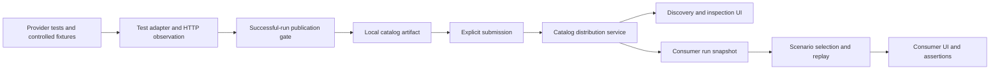
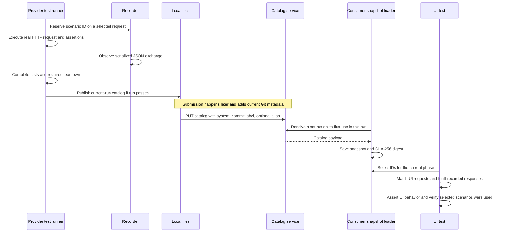

# RFC: Provider-derived scenarios for independent UI testing

Status: research complete; decision pending. Researched October 12, 2026.

## 1. Problem and decision requested

Consumer teams need realistic API scenarios to test their applications independently. Keeping those scenarios aligned with provider behavior creates ongoing maintenance work, while running tests against a live provider requires service availability and controlled state. The problem is how to make provider behavior reusable as test data and establish what confidence that reuse gives consumers.

This RFC evaluates three connected patterns: capturing selected exchanges from passing provider tests, publishing those exchanges as discoverable artifacts, and letting consumers select and replay them in their own tests. Together, these patterns could allow provider tests to supply scenarios that multiple consumers and testing tools can reuse.

Their potential value to the API testing ecosystem is a common way to produce, discover, and consume scenarios grounded in tested provider behavior. A portable format and clear integration boundaries could support different frameworks and reduce duplicated fixture authoring. That value must be evaluated against two equally important criteria: whether consumers can run repeatable UI tests without the provider, and how much confidence those tests provide in provider/consumer compatibility. The RFC examines where these patterns add value alongside conventional mocks, schema-based testing, consumer-driven contracts, and live-provider tests.

**The decision requested is whether these patterns merit further development as reusable tooling for the ecosystem, and what role that tooling should serve.** The recommendation is to continue evaluating their value for independent UI testing and determine which additional verification is needed to support compatibility claims. The review should establish the intended guarantees and how the patterns fit with existing approaches.

## 2. Proposed approach

### General pattern

A **scenario** is one concrete request and response observed during a passing provider test. A **catalog** collects scenarios under stable scenario IDs. A **replay phase** is the set of scenarios currently available to a consumer test.



Distribution can be an artifact repository or another transport; a continuously running catalog service is a demonstration choice. The reusable contract, recorder, and client packages separate data validation, observation, runner acceptance, persistence, and replay. Framework independence here means those boundaries can support other adapters; portability to other runners and languages has not been demonstrated. [D01, D07, D23]



The current prototype publishes only after the capture runner reports success. It does not require a catalog server during capture. Upload and first consumer lookup each need the catalog service. After a source is loaded, workers and retries share its snapshot. Different sources resolve independently on first use; they do not form a simultaneous, cross-provider release snapshot. [D02–D05, D10, D21]

### Capturing a scenario on the provider side

The following excerpts use the prototype's current adapters to make the pattern concrete. In a provider test, the author assigns a stable scenario ID to a selected request and keeps the usual assertions. Here, `usePetstoreFixture()` supplies a real application with a fresh database and registers its setup and teardown hooks:

```ts
// Provider test excerpt, using the existing Petstore fixture.
import { expect, it } from 'vitest';
import { capture } from '@response-capture/scenario-recorder/supertest';
import { pet, usePetstoreFixture } from './support/petstore-fixture.js';

const fixture = usePetstoreFixture();

it('creates a pet with defaults', async () => {
  const response = await fixture
    .api()
    .post('/pet')
    .send(pet)
    .use(
      capture('pet.create.success', {
        title: 'Create a pet with defaults',
        requestMatch: { bodyContains: { name: 'Milo' } },
      }),
    )
    .expect(201);

  expect(response.body).toEqual({
    ...pet,
    id: 1,
    tags: [],
    status: 'available',
  });
});
```

The marker selects the exchange for capture; it does not replace the server or the assertions. The optional matching hint constrains later replay and must match the captured request.

The ID `pet.create.success` belongs to an existing provider test. When adapting this snippet to capture another exchange, assign a new stable ID. IDs must be unique across a capture run; duplicate IDs prevent catalog publication.

Enable capture through a dedicated runner configuration that retains the provider's existing E2E configuration:

```ts
// vitest.config.capture.ts
import { defineConfig, mergeConfig } from 'vitest/config';
import { scenarioCapture } from '@response-capture/scenario-recorder/vitest';
import e2e from './vitest.config.e2e.js';

export default mergeConfig(
  e2e,
  defineConfig({
    test: scenarioCapture({ outputDirectory: 'artifacts/api-scenarios' }),
  }),
);
```

The runner writes the current-run catalog only after the tests and required teardown pass. Unmarked setup requests are excluded, and markers are inert in ordinary test runs. Publication to the distribution service is a separate action. [D01–D05, D11, D20]

With workspace dependencies built, run the existing marked provider suite from the repository root:

```sh
npm run scenarios:capture --workspace=@response-capture/petstore-api
```

### Compact recorded scenario

This is a shortened illustration of `pet.create.success`, not the exact walkthrough payload:

```json
{
  "schemaVersion": 1,
  "id": "pet.create.success",
  "request": {
    "method": "POST",
    "path": "/pet",
    "body": { "name": "Milo", "photoUrls": [] },
    "match": { "bodyContains": { "name": "Milo" } }
  },
  "response": {
    "status": 201,
    "headers": { "content-type": "application/json; charset=utf-8" },
    "body": {
      "id": 1,
      "name": "Milo",
      "photoUrls": [],
      "tags": [],
      "status": "available"
    }
  }
}
```

The wire schema validates JSON values and exchange structure. It does not validate `Pet`, `PetInput`, business rules, or consumer expectations. Optional TypeScript body declarations are trusted application assertions about data, with no corresponding runtime validator. [D06–D08]

### Publishing and discovering scenarios through the catalog system

The catalog system connects provider capture to consumer selection. Providers publish catalogs under a system identity; consumers locate a catalog for that system and select scenario IDs within it. This gives multiple consumers a shared source of recorded scenarios. Storage and delivery are separate from capture and replay, so the general pattern could use an artifact repository or another distribution mechanism. The prototype implements this role with a catalog API and a scenario browser. [D09, D19, D23]

**Publication and storage.** The provider's submission script reads the local catalog and sends it to `PUT /catalog-submissions`. The submission envelope identifies the provider system and a commit, with an optional alias such as a branch name. For the recorded scenario above, its structure is:

```ts
// Submission shape: capturedScenario is the recorded exchange shown above.
const submission = {
  systemName: 'petstore-api',
  commitHash: '<full-commit-hash>',
  alias: 'main',
  catalog: {
    catalogVersion: 1,
    scenarios: [capturedScenario],
  },
};
```

The actual script submits every scenario in the captured file and resolves Git metadata at submission time. That commit label therefore identifies the submitting checkout; it does not establish which code produced the recording. To publish through the local service, start the catalog API before running the submission command:

```sh
# From the repository root, start the local service in another terminal.
npm run dev --workspace=catalog-api
# Once it is ready, publish the provider's captured catalog.
npm run scenarios:submit --workspace=@response-capture/petstore-api
```

The API persists submissions in SQLite under `(systemName, commitHash)`. A successful submission returns `204`. Submitting the same pair again replaces the entire catalog, refreshes its submission timestamp and replaces its alias; omitting the alias clears it. It does not merge individual scenarios. The API validates the submission envelope but accepts arbitrary catalog objects. Scenario validation occurs in the recorder, the provider submission script and the consumer/browser loaders. [D07, D09–D11]

**Lookup and selection.** The API exposes these operations:

| Operation                             | Purpose and returned data                                                                                                   |
| ------------------------------------- | --------------------------------------------------------------------------------------------------------------------------- |
| `PUT /catalog-submissions`            | Store or replace a catalog submission                                                                                       |
| `GET /catalog-submissions`            | Inspect stored submissions, including their metadata and catalog payloads                                                   |
| `GET /catalog-inventory`              | Discover systems and catalog versions, with commit labels, optional aliases and submission dates; excludes catalog payloads |
| `GET /catalogs/:systemName`           | Retrieve the most recently submitted catalog for a system                                                                   |
| `GET /catalogs/:systemName/:selector` | Retrieve the newest catalog matching an alias or commit label                                                               |

For example, these read-only requests inspect inventory, retrieve the latest Petstore catalog, and select one by the `main` alias if that alias has been submitted:

```sh
curl http://localhost:3001/catalog-inventory
curl http://localhost:3001/catalogs/petstore-api
curl http://localhost:3001/catalogs/petstore-api/main
```

The two catalog lookup routes return the catalog object itself, or `404` when no match exists. Latest means latest submission, not newest Git revision. Selector matching is exact and case-sensitive; path segments must be URL-encoded. If an alias matches another entry's commit label, the newest matching submission wins. Because entries can be replaced, selecting a commit does not make the payload immutable. Lookup also omits resolved-commit metadata, so a consumer snapshot records the requested selector and payload digest rather than inferring the revision behind an alias. [D10–D12]

**Discovery for test authors.** The catalog UI reads inventory, lets authors choose a system and Latest or a recorded commit, and displays the selected catalog's scenarios. Authors can search and filter by metadata and inspect IDs, methods, paths, matching hints, response statuses and JSON bodies before choosing references for a consumer test. With the catalog API running, start it locally with:

```sh
npm run dev --workspace=catalog-ui
# Open http://localhost:4201/.
```

Browsing does not execute provider requests or establish that independently recorded scenarios form a coherent journey. The catalog system distributes and exposes the data; the consumer owns scenario selection and journey assertions. Capture can run without this system, while publication and a consumer's first lookup require its API. Once loaded, the consumer's run-scoped snapshot supplies that source to its workers and retries. Shared-service access control, retention and availability requirements remain decisions for broader use. [D09, D12, D16, D19, D22]

### Consuming scenarios on the consumer side

The consumer declares where to obtain a catalog and which API requests replay should guard. The alias `pets` below is a local name for the source, while `petstore-api` identifies the published provider. The `ui` origin resolves to the test's configured UI origin:

```ts
// e2e/support/fixtures.ts — minimal replay integration.
import { test as base, expect } from '@playwright/test';
import { scenarioFixtures } from '@response-capture/scenario-client/playwright';

export const test = base.extend(
  scenarioFixtures({
    catalogs: {
      pets: {
        catalogApiUrl: 'http://localhost:3001',
        systemName: 'petstore-api',
        selection: { latest: true },
        routing: { origin: 'ui', protectedPaths: ['/pet', '/store', '/training'] },
      },
    },
  }),
);

test.use({ scenarioReplayPolicy: 'error' });
export { expect };
```

Strict replay rejects unmatched requests within these API boundaries. Latest is convenient for local exploration; version and artifact identity choices are discussed in D10–D12. Start the run-scoped snapshot loader through global setup, and register it in the existing Playwright configuration alongside the application's server and project settings:

```ts
// e2e/global-setup.ts
import { scenarioGlobalSetup } from '@response-capture/scenario-client/playwright';

export default scenarioGlobalSetup({ outputDirectory: 'test-results/catalog' });
```

```ts
// playwright.config.ts — excerpt showing the required settings.
import { defineConfig } from '@playwright/test';

export default defineConfig({
  globalSetup: './e2e/global-setup.ts',
  use: { baseURL: 'http://localhost:4202', serviceWorkers: 'block' },
});
```

Merge these settings with the application's existing configuration; preserve its other `use` settings and compose any existing global setup. The prototype already configures this setup and starts its UI server. The loader fetches each requested catalog source once per run and shares its snapshot across workers and retries. [D12, D13, D18]

Application-owned references give the scenario IDs names and body types for test authoring. These types are trusted declarations, not runtime validation of provider payloads:

```ts
// e2e/support/scenarios.ts — excerpt of the application's references.
import type { Pet, PetInput } from '@response-capture/contracts/petstore';
import { scenarioReferences } from '@response-capture/scenario-client';

type CreatePetRequest = Omit<PetInput, 'status' | 'tags'> &
  Partial<Pick<PetInput, 'status' | 'tags'>>;

const pets = scenarioReferences('pets');
export const petScenarios = {
  create: pets.define<CreatePetRequest, Pet>('pet.create.success'),
  detail: pets.define<null, Pet>('pet.read.after-order-deletion'),
};
```

The consumer test selects its scenarios **before** triggering requests. This creation journey uses the captured input to fill the form and the captured response to assert the saved details:

```ts
// e2e/pets.spec.ts — creation journey excerpt.
import { test, expect } from './support/fixtures';
import { petScenarios } from './support/scenarios';

test('create a pet and show its saved details', async ({ page, replay }) => {
  const { create, detail } = await replay.replace({
    create: petScenarios.create,
    detail: petScenarios.detail,
  });

  const input = create.request.body;
  const saved = create.response.body;

  // The recordings are independent: check that the follow-up is coherent.
  expect(detail.response.body).toEqual(saved);

  await page.goto('/pets/new');
  await page.getByLabel('Name', { exact: true }).fill(input.name);
  await page.getByLabel('Photo URLs (optional)').fill(input.photoUrls.join('\n'));
  await page.getByRole('button', { name: 'Save pet' }).click();

  await expect(page).toHaveURL(`/pets/${saved.id}`);
  await expect(page.getByRole('status')).toHaveText('Pet saved.');
  await expect(page.getByRole('heading', { name: saved.name, exact: true })).toBeVisible();

  expect(create.calls()[0]?.body).toMatchObject({
    name: input.name,
    photoUrls: input.photoUrls,
  });

  create.assertUsed();
  detail.assertUsed();
});
```

The create and detail scenarios come from different provider tests. The detail response was recorded after an order was deleted, but it describes the same pet returned by the create scenario. The consumer test checks that the two responses agree before using them together. [D16, E3]

When the UI sends a selected request, replay returns its recorded response. The test's assertions check the resulting navigation, displayed content and request fields. At the end of the test, the replay fixture checks that every selected scenario was requested at least once. [D14, D17–D18]

To read a scenario without replaying requests, use `await catalogs.get(petScenarios.create)`. This returns the recorded exchange and information about its catalog source, without installing network handlers. [D08, D18]

A test can change the available responses as the journey progresses. Calling `await replay.replace({ ... })` replaces all currently selected scenarios. The deletion journey uses this sequence:

1. Select the detail scenario and open the pet's page.
2. Before confirming deletion, select the deletion, empty-list and empty-inventory scenarios.
3. Confirm deletion. The UI receives the recorded deletion response, then the empty results when it loads the list and inventory.

The test author must choose follow-up scenarios that fit the journey. Replay does not maintain a simulated database or derive the empty results from the deletion request. [D16, E3]

The prototype uses NestJS and isolated SQLite databases for provider tests; Supertest markers and a Vitest adapter for capture; a NestJS/SQLite catalog; Angular for both the consumer and catalog browser; and Playwright for replay. Catalog UI discovers systems and versions, filters metadata, and displays exchanges. It neither executes scenarios nor certifies coverage or compatibility. [D01, D09, D19]

## 3. Architectural suggestions

**Keep selective capture and require the entire capture run to pass before publishing.** Authors mark the requests they want in the catalog and leave setup requests unmarked. The tests keep their normal request chains and assertions. The recorder publishes a catalog only after the tests, required teardown and captured-exchange validation to pass. Receiving an HTTP response is only one step; a later assertion or teardown failure will prevent publication. [D01–D03]

An error response can be a useful scenario. For example, a test that expects and verifies a `404` response can pass and contribute that exchange to the catalog. The confidence it provides depends on what the author asserts about the response. [D01–D02]

For retried tests, only the final passing attempt contributes scenarios. Skipped tests and tests marked as expected failures contribute none. Parallel workers within one capture run can share an output directory, but independently launched capture commands need separate directories to avoid overwriting each other's catalogs if the file system continues to be used as intermediate storage. [D03–D04]

**Keep capture and submission separate, and record which code produced each capture.** Separate commands allow provider tests to generate a catalog without the catalog service running. If an upload fails, the author can retry it without rerunning the tests. [D04, D11]

Currently, submission reads the existing `catalog.json` and includes the current Git commit and branch. For example, a catalog captured at commit A could be submitted after switching to commit B and be labeled as coming from B. A failed capture at B also leaves the older catalog available for submission. The script does not check whether the file came from the current checkout or whether the captured code included uncommitted changes. [D04, D11]

One suggested enhancement is to save a metadata file alongside the catalog when capture runs. It should record:

- The provider's Git revision and whether it has uncommitted changes.
- Which tests were selected.
- The test runner and configuration used.
- A digest identifying the captured catalog's contents.

Submission should use this capture metadata to identify the recorded code and verify that the catalog still matches its digest. CI should check the metadata against agreed publication rules before uploading. Captures made with uncommitted changes may be useful for local exploration; whether they can also serve as release evidence remains an organizational policy decision.

**Give each published catalog an identity that always refers to the same contents.** Currently, submitting a catalog again for the same system and commit overwrites the previous catalog. Two test runs selecting that commit can therefore receive different data. Selecting a full Git hash does not make the catalog immutable. [D09–D10]

Latest and alias lookup also depend on submission order. In addition, the API checks a selector against both aliases and commit hashes. If it matches an alias on one entry and a commit hash on another, the most recently submitted match wins. [D10]

The recommended enhancements would be:

- Store each catalog under a digest computed from its contents, and never overwrite that stored catalog. Changed contents produce a new digest and a separate catalog.
- Keep aliases such as `main` as separate references that can be updated to point to a different catalog.
- Provide separate lookup operations for commits and aliases so their names cannot be confused.
- Return the recorded provider revision, the capture run that produced the catalog, and its digest with lookup results. This lets consumers record exactly what they tested.

Keep the existing snapshots for each consumer test run. Workers and retries already reuse the same loaded catalog for a source, even if the service changes during the run. Digest verification checks that a snapshot still matches its saved digest; it does not prove who produced or published the catalog. [D12]

**Use strict replay explicitly for tests intended to run without the provider.** The library's default policy, `fallback`, returns recorded responses for selected scenarios and passes unmatched requests to existing mocks or the real network. This lets authors add replay to an existing test suite gradually. [D13, D18]

Strict replay, configured with `scenarioReplayPolicy: 'error'`, blocks unmatched requests to the APIs the test declares. The Petstore tests use this policy. Authors specify each API's origin (protocol, host and port) and protected path roots. For example, protecting `/pet` also protects `/pet/1`, but requests to another host or an undeclared API path still pass through. [D13]

The current adapter intercepts requests from the test's Playwright page. It requires service workers to be blocked so they cannot bypass that interception. Other page request handlers registered later can take priority over replay, so authors must also account for overlapping mocks. Requests from other pages or server-side code need separate handling. [D18, D23]

A passing strict replay test therefore supports provider independence only for the tested requests covered by its routing rules and interception setup. Authors must cover every provider request used by the journey before treating it as a test that runs independently of that provider. [D13, D18, D23]

**Choose scenarios explicitly, and check request compatibility separately.** Selecting a scenario tells replay which recorded response to return. It does not establish that the provider would accept the request sent by the consumer. Replay matches the HTTP method and URL path on the configured origin, rejects query parameters and malformed JSON, and applies any `bodyContains` hint. [D14]

A `bodyContains` hint checks only the specified body fields. For example, a hint requiring `name: 'Milo'` can pass even when the request also contains an invalid `status`. Other body fields and request headers are not checked. The recorded response can therefore be returned for a request that would fail against the provider. [D06, D14, E4]

Authors must select only one scenario for each method and URL in a phase. Two scenarios for `POST /pet` cannot be active together, even if they have different body hints: the library rejects that selection rather than using the hints to choose a response. [D15]

Keep this explicit selection model, but evaluate additional checks for compatibility. Options include validating requests against API schemas, checking required headers, or using consumer-driven contracts to verify consumer requirements against the provider. Comparing the entire request body with the recorded body is a useful starting experiment, though it can reject valid requests with different values or additional optional fields. Any more flexible matching rules should state exactly what they accept and be verified against provider behavior.

**Keep explicit phase changes, and check that the selected scenarios fit the journey.** Each call to `replay.replace()` starts a phase with a new set of available scenarios. Every selected scenario must be requested at least once while that phase is active. Selecting a new phase does not erase an unused selection from an earlier phase. Repeated matching requests receive the same recorded response; replay does not check exact request counts or their order within a phase. [D16–D17]

Scenarios from separate provider tests may describe different data. For example, a create scenario might return pet 1 named Milo, while a detail scenario for pet 1 returns Luna because its provider test used different setup data. Both scenarios can be valid individually but inconsistent when used in the same consumer journey. Authors need to check that the selected requests and responses describe compatible resources and relationships. [D16, D20]

The recommendation is to collect scenarios and their consistency checks in named, reusable journey fixtures, such as a fixture for creating a pet and viewing its details. A fixture could check that the create and detail responses agree, or that an order refers to the expected pet. Tests should also assert request counts and order when those are requirements of the journey.

Continue using explicitly selected responses for each phase. Consider a backend simulator that tracks and updates state only if experiments show that these phases cannot represent the UI journeys that need testing.

**Treat the narrow wire format as a prototype constraint.** The current scenario format records only part of an HTTP exchange:

- Bodies must be JSON. File uploads and other non-JSON payloads cannot be captured by the supplied adapter.
- Paths identify specific resources, such as `/pet/1`, rather than reusable patterns such as `/pet/:id`.
- Query parameters are unsupported. The Petstore provider tests exercise filters such as `/pet/findByStatus?status=available`, but those requests are left unmarked and do not appear in the catalog.
- Request headers are not stored, and only the response's `content-type` header is retained. Replay therefore cannot check recorded authorization headers or reproduce response headers such as cookies or `Location`.

These restrictions simplify capture and replay, but leave some API behavior outside the scenarios that consumers can test. They are choices in this prototype's format and adapter, rather than requirements of the overall approach. [D06–D08, D20]

Future format versions could support more of these exchanges. Recorders and consumers would need to agree on supported versions, and existing catalogs would need either conversion or continued support. Unknown structural fields should produce clear errors so that a consumer does not silently ignore information it cannot interpret. [D07]

A richer format would still contain only the scenarios authors chose to record. It could represent more kinds of requests, but passing those scenarios would not establish compatibility for every input, provider state or request sequence. [D20]

## 4. Guarantees, limitations, and alternatives

### Guarantee matrix

Each layer establishes a different fact; passing all four does not establish compatibility for inputs or versions they never checked.

| Layer                            | Establishes                                                                                                                                         | Leaves unchecked                                                                                                               | Evidence         |
| -------------------------------- | --------------------------------------------------------------------------------------------------------------------------------------------------- | ------------------------------------------------------------------------------------------------------------------------------ | ---------------- |
| Provider assertions and run gate | Selected real exchanges came from accepted provider test attempts; the run and supported observation passed                                         | Unasserted response meaning; unrecorded cases; consumers' actual requests; deployment configuration; capture revision identity | D01–D03, D11; E2 |
| Exchange schema validation       | Supported versions, valid JSON, structural fields, unique IDs, concrete paths, hint consistency                                                     | Domain body types, auth rules, state coherence, response meaning, backward compatibility                                       | D06–D08; E1      |
| Replay matching and verification | Active method/origin/path matched; selected requests parsed as JSON, had no query, satisfied supplied hints; every selection was used at least once | Other body fields, request headers, provider accepting the request, exact call count/order, persistence, unprotected traffic   | D13–D18; E1, E4  |
| Consumer/UI assertions           | Tested UI behavior for supplied scenarios, including tested rendering, navigation and DOM accessibility checks                                      | Real integration for changed requests; unseen response variation; all runtime accessibility or deployment behavior             | D16, E3          |
| Run snapshot and digest          | Same source URL resolves once within a run; saved catalog still matches its recorded digest                                                         | Authentic producer, resolved alias commit, reproducibility across runs, coherent multi-provider versions                       | D10–D12, D21; E1 |

### Concrete failure and false-confidence examples

1. **Demonstrated request incompatibility:** the captured create scenario checks only `name: "Milo"`. Replaying `{ "name": "Milo", "photoUrls": "not-an-array", "status": "lost", "unknown": true }` returned 201 twice and passed verification. Existing provider tests reject those invalid fields individually, and provider DTO validation rejects their types/values. The exact combined input was probed against replay, not separately against a live provider. This proves replay does not enforce the provider's recorded input constraints. [D14, E4]
2. **Demonstrated positive failures:** unknown IDs and ambiguous active routes fail before replacement; malformed JSON, unexpected queries, hint violations, unmatched protected requests in strict mode, and unused selections fail appropriately. An unused old phase stays unused after replacement. These diagnostics are useful without proving full request compatibility. [D13–D17, E1]
3. **Breaking-change hypothesis:** a provider changes a required response field from `name` to `displayName`. A fresh capture replayed into assertions that require `name` can expose the break; a stale or pinned old catalog can keep passing while the changed provider is unusable. No deliberate provider mutation was performed in this research. [D11, D20; inference]
4. **Protocol hypothesis:** a new authorization requirement or changed cookie/Location behavior can remain invisible because those protocol fields are absent from replay. This was inferred from capture and matching code, not tested through an authentication mutation. [D06, D14]
5. **State limitation:** a successful DELETE does not alter subsequent GET/list responses until the author changes the active scenarios. Explicit-phase and browser deletion tests demonstrate the replacement workflow, not that a real multi-step transaction would produce the assembled state. [D16, E3]
6. **Provenance limitation:** a failed capture followed by submission can publish the retained older catalog under the current HEAD. Tests separately demonstrate failure preservation and submission-time Git lookup; this exact two-command stale-relabel sequence was not executed against a changed checkout. [D02, D11; inference]

The recommendation depends on demonstrated behavior, not an assumed speed advantage. Recorded durations in the appendix describe this checkout's verification runs; there is no live-provider baseline or performance benchmark.

### Focused comparison

The following is an architectural evaluation using current primary documentation, not a benchmark or a vendor selection. Authoring and maintenance comparisons are reasoned tradeoffs; team-specific effort remains unmeasured.

| Approach                                       | Compatibility confidence and fidelity                                                                                                                                                             | Independence and authoring                                                                                                        | Maintenance, distribution and CI coupling                                                                                                                                                                                                                                                                                                                    |
| ---------------------------------------------- | ------------------------------------------------------------------------------------------------------------------------------------------------------------------------------------------------- | --------------------------------------------------------------------------------------------------------------------------------- | ------------------------------------------------------------------------------------------------------------------------------------------------------------------------------------------------------------------------------------------------------------------------------------------------------------------------------------------------------------ |
| Current provider-derived replay                | Real provider scenarios; structural validation and selective matching. Does not verify actual consumer requests against the provider                                                              | Consumer runs without provider after catalog lookup; reuse provider tests, then select cases and coherent phases                  | Provider owns scenarios; consumers own selection/assertions. Current mutable catalog and first-use service dependency require coordination. D01–D23                                                                                                                                                                                                          |
| Consumer-driven contracts, represented by Pact | Consumer tests generate expected interactions; provider verification executes them against provider state and checks required response content. Still bounded by declared interactions            | Separate consumer and provider tests; requires writing consumer expectations and provider state setup                             | Publish contracts and version-specific verification results; Broker tooling supports deployment compatibility checks. Adds explicit cross-team CI coordination. [How Pact works](https://docs.pact.io/getting_started/how_pact_works), [Provider verification](https://docs.pact.io/provider), [Can I Deploy](https://docs.pact.io/pact_broker/can_i_deploy) |
| OpenAPI/schema-based testing                   | Describes bodies and protocol parameters. Tools such as Schemathesis check live responses against schemas and exercise generated inputs; consumer business assumptions need additional assertions | Schema can be distributed independently; provider conformance tests need a provider. UI fixtures/replay need a separate mechanism | Maintain schemas plus conformance checks and consumer coverage. CI can test provider conformance separately; schema publication alone supplies no verification result. [OpenAPI 3.2.1](https://spec.openapis.org/oas/v3.2.1.html), [Schemathesis checks](https://schemathesis.readthedocs.io/en/stable/reference/checks/)                                    |
| Conventional mocks or HAR replay               | Behavior/fidelity depends on authored or recorded fixtures and matchers; mock success supplies no inherent provider verification                                                                  | Independent UI tests; direct fixture control for edge cases and journeys                                                          | Local/versioned files need little distribution infrastructure but can drift; fixtures and matching remain the consumer team's responsibility. [Playwright mocking](https://playwright.dev/docs/mock)                                                                                                                                                         |
| Live-provider E2E                              | Exercises actual requests, responses and state through the configured system for tested journeys; deployment-specific failures can be visible                                                     | Needs running UI/provider, state control and dependencies; authors assert real journeys                                           | Couples execution to service readiness and environment state; version matrix coverage still must be chosen. Playwright supports starting multiple web servers; effort/reliability here is inferred, not measured. [Web servers](https://playwright.dev/docs/test-webserver), [Test isolation guidance](https://playwright.dev/docs/best-practices)           |

Provider-derived replay is most promising as a maintained source of realistic fixtures paired with explicit compatibility checks. Pact is a stronger candidate when actual consumer requirements and verified version pairs are the central requirement. Schema validation can address structural gaps without replacing consumer assertions or stateful integration tests. Conventional mocks may be sufficient if the cost of keeping fixtures correct is already low. Retain targeted live-provider journeys for boundaries that static scenarios omit.

## 5. Recommendation and review questions

Continue only through a bounded experiment that assesses both UI independence and compatibility detection. Preserve the current library boundaries and selective capture, but establish artifact identity and stronger request checks before treating replay results as release evidence. The current implementation remains a useful demonstration rather than an adoption decision.

| Experiment                                                                                                                | Evidence to collect                                                                                                                                                      | Decision it resolves                                                                         |
| ------------------------------------------------------------------------------------------------------------------------- | ------------------------------------------------------------------------------------------------------------------------------------------------------------------------ | -------------------------------------------------------------------------------------------- |
| Compare exact body matching, request-schema validation, and a small consumer-driven contract slice for the create journey | Inject missing required fields, invalid enums, optional extra fields, and a required response-field rename; report detected/missed cases for each layer and version pair | Whether custom replay can meet the compatibility objective or should remain a fixture layer  |
| Capture identity and immutable artifact prototype, after approval                                                         | Attempt stale-file submission, dirty capture, filtered publication, same-commit replacement and alias/hash collision; retry consumers against retained digests           | Required provenance and retention model                                                      |
| Coherent journey authoring with a second provider                                                                         | Count manual declarations and cross-scenario assertions; deliberately remove an ID and introduce incompatible resource identities; use explicit provider version pairs   | Whether coverage ownership and multi-provider composition are manageable                     |
| Compare isolated replay with selected live journeys                                                                       | Record reproducibility, failures, setup work and runtime over repeated runs under the same environment                                                                   | Whether independence materially improves the team's workflow; no numerical target is assumed |

These are proposed subsequent experiments, not implemented changes. Use the demonstrated Petstore creation/deletion journeys to bound the first evaluation instead of extending every endpoint or transport.

Before use beyond a local prototype, resolve these prerequisites:

- Assign ownership of provider IDs, fixture stability, consumer journey selection, and removal/deprecation handling. No owners are established by this repository.
- Decide capture eligibility and CI order: acceptable full-suite selection, successful provider capture, validation and immutable publication must precede a consumer's first use of the intended artifact. Independent jobs can exchange a pinned artifact; latest alone cannot establish the intended version pair.
- Specify retention for capture manifests, catalogs, consumer snapshots and diagnostics so failures and retries remain explainable. Duration and storage scale are unknown.
- Define authentication and read/write authorization for shared catalogs, payload sensitivity rules, and synthetic-data/redaction policy. Current bodies and diagnostics can contain sensitive values; the service has no configured authentication or recorder redaction.
- Decide who operates distribution, persistence/backups, availability and recovery. SQLite is adequate evidence of local persistence, with no demonstrated shared-service capacity or deployment topology.
- Decide required transport/framework support. Browser page interception is insufficient for server-side consumers or non-JSON/query-heavy APIs without additional adapters and representation changes. [D19–D23]

Possible enhancements after those decisions include generated reference declarations, ID coverage reports and deprecation inventories, richer query/header support, offline snapshot loading, signed attestations, or alternate catalog stores. None is assumed necessary for every use case.

Reviewers should challenge concrete choices:

1. Is the intended product a provider-derived fixture library, a compatibility gate, or both? If both, which real request and response mutations must it detect compared with consumer-driven contracts?
2. Should immutable digest identity supersede system/commit replacement, and should commit and alias have separate routes?
3. Should isolated replay require strict routing by default, while mixed-mode fixtures explicitly choose fallback?
4. Should body matching use exact recorded request bodies, domain schemas, or consumer-declared matchers? What input variation must remain valid?
5. Should shared publication reject filtered/empty captures, or publish them under distinct coverage manifests?
6. Should journey coherence remain consumer assertions, become named fixture checks, or use selected live-provider journeys?
7. Should distribution use the existing service or ordinary CI artifacts, and who owns retention and availability?
8. Which query/header/authentication behaviors are prerequisites, and which belong in a different test layer?

## Evidence appendix

### A. Checkout, scope and method

Checkout revision: `7aaccd43e36f9e8ec469918f6cdb3081b3bdc88f`. Initial working tree: modified `package-lock.json` (4 additions, 97 deletions) and untracked `docs/`, containing the research plan. These changes were preserved. Runtime for successful runs: Node `v24.13.1`, npm `11.8.0`; installed Vitest `4.1.11`, Playwright `1.56.1`. The research added this RFC only; compilation outputs/caches were generated and temporary configs, recordings, snapshots, browser binaries and the walkthrough database were placed outside tracked source. No shared service received submissions. No Turborepo configuration or commands were changed or used.

Evidence labels: **documented** means the rationale appears in repository documentation; **inferred** means it is this RFC's interpretation of implementation tradeoffs. Test names below identify supporting checks, not proofs beyond their assertions. Untested interruption/mutation/operational behavior is explicitly labeled. Paths are relative to this RFC.

### B. Capture and exchange decisions

| ID / current behavior                                                                                                                                                       | Source location                                                                                                                                                                            | Supporting test / execution                                                                                                                                                         | Rationale                                                                                                               | Tradeoff and plausible alternative                                                                                                                                                                                                                                                                           |
| --------------------------------------------------------------------------------------------------------------------------------------------------------------------------- | ------------------------------------------------------------------------------------------------------------------------------------------------------------------------------------------ | ----------------------------------------------------------------------------------------------------------------------------------------------------------------------------------- | ----------------------------------------------------------------------------------------------------------------------- | ------------------------------------------------------------------------------------------------------------------------------------------------------------------------------------------------------------------------------------------------------------------------------------------------------------ |
| D01: Explicit Supertest markers reserve one ID; AsyncLocalStorage and native request association isolate observation. Unmarked requests and ordinary-run markers are inert  | [supertest.ts](../packages/scenario-recorder/src/supertest.ts), [context.ts](../packages/scenario-recorder/src/context.ts), [node.ts](../packages/scenario-recorder/src/node.ts)           | Recorder `node.spec.ts`: serialized JSON, concurrent sessions, inert markers; `consumer.spec.ts`: external built-package import; E1                                                 | Documented: preserve native assertions and exclude setup requests, [usage](../packages/scenario-recorder/docs/usage.md) | Authors decide coverage; custom adapters must manage observation and runner lifecycle. Alternative: automatic traffic/HAR capture, with explicit noise filtering                                                                                                                                             |
| D02: Per-attempt sessions finish only for passing, non-expected-failure, non-aborted attempts; reporter publishes only a passed run without errors                          | [vitest-setup.ts](../packages/scenario-recorder/src/vitest-setup.ts), [vitest.ts](../packages/scenario-recorder/src/vitest.ts), [session.ts](../packages/scenario-recorder/src/session.ts) | Recorder `vitest.spec.ts`: later assertion, Supertest expectation, afterEach/afterAll, finished/outer hooks, timeout, unhandled error, unawaited request; E1                        | Documented: publish accepted scenarios and preserve the prior catalog                                                   | Whole-run gate blocks unrelated scenarios on failure; caught ordinary assertions are only as trustworthy as runner outcome. Alternative: per-scenario evidence with explicit partial-run status                                                                                                              |
| D03: Final passing retries and workers contribute current-run data; skipped/expected-failure attempts excluded; duplicate IDs reject publication                            | [vitest.ts](../packages/scenario-recorder/src/vitest.ts)                                                                                                                                   | Recorder `vitest.spec.ts`: current successful run across concurrent tests/parallel workers; duplicate-ID failure; E1                                                                | Documented: current-run isolation and unique IDs                                                                        | Vitest retries supported; actual HTTP retries/redirects rejected by Supertest adapter. Alternative: record attempt IDs or explicit multi-exchange scenarios                                                                                                                                                  |
| D04: UUID archive and latest local catalog written separately; each file uses temporary write then rename; merge is local-only                                              | [writer.ts](../packages/scenario-recorder/src/writer.ts), [files.ts](../packages/scenario-recorder/src/files.ts), [vitest.ts](../packages/scenario-recorder/src/vitest.ts)                 | Recorder `files.spec.ts`: deterministic ordering, duplicate preservation, empty merge; `vitest.spec.ts`: publication failure; E1                                                    | Documented: retain successful runs and retry submission separately                                                      | No two-file transaction, fsync durability or coordination of independent publishers. A process kill between renames may leave an archive without latest update; kill after latest rename can leave changed output. Untested interruption hypothesis. Alternative: immutable artifact plus one atomic pointer |
| D05: Filtered passing runs replace latest with only their scenarios; passing tests with no markers publish an empty catalog                                                 | [vitest.ts](../packages/scenario-recorder/src/vitest.ts), [usage](../packages/scenario-recorder/docs/usage.md)                                                                             | E2 filtered run: two scenarios; marker-free run: zero scenarios; reporter current-run test E1                                                                                       | Documented: publish only the current run                                                                                | Selection completeness is not encoded; upload can replace a full catalog with a partial/empty one. Alternative: record selection/coverage manifest and separate exploratory output from eligible full publication                                                                                            |
| D06: JSON parsed from serialized requests/responses; concrete path and method retained; request headers omitted; only response JSON content-type retained; queries rejected | [node.ts](../packages/scenario-recorder/src/node.ts), [scenarios.ts](../packages/contracts/src/scenarios.ts)                                                                               | Recorder `node.spec.ts`: serializers, merged sends, JSON primitives/null, query/text/compression/redirect failures; provider `pet.e2e-spec.ts` leaves query filters unmarked; E1/E2 | Documented: deliberately supported JSON exchanges. Inferred: narrow format simplifies replay                            | No byte fidelity, auth/cookie/Location checks; absent body and JSON null conflated. Streaming, HTTP/2, multipart and mocked responses unsupported. Alternative: versioned richer HTTP representation                                                                                                         |
| D07: Version 1 validators reject unknown structural fields, duplicate IDs, invalid JSON and inconsistent hints, but bodies remain arbitrary JSON                            | [scenarios.ts](../packages/contracts/src/scenarios.ts)                                                                                                                                     | Contracts `scenarios.spec.ts`: 33 checks, including JSON values, unknown fields, versions, paths, duplicate IDs and hints; recorder session/file tests; E1                          | Documented: shared browser-safe validation at recording/loading boundaries                                              | Does not enforce domain schemas. New structural fields require coordinated version handling. Alternative: envelope version negotiation plus separate domain validators                                                                                                                                       |
| D08: Body types on references exist only in TypeScript declarations; scenarios/handles are cloned                                                                           | [references.ts](../packages/scenario-client/src/references.ts), [catalog.ts](../packages/scenario-client/src/catalog.ts)                                                                   | Client `core.spec.ts`: typed examples, ownership and atomic invalid replacements; `typecheck.ts` compile; E1                                                                        | Documented in code: trusted application types                                                                           | Compile-time convenience can overstate actual payload type. Alternative: supply runtime validators or generate types and validators from an authoritative schema                                                                                                                                             |

Recorder test files: [Vitest integration](../packages/scenario-recorder/test/vitest.spec.ts), [HTTP observation](../packages/scenario-recorder/test/node.spec.ts), [sessions](../packages/scenario-recorder/test/session.spec.ts), [file handling](../packages/scenario-recorder/test/files.spec.ts), [external consumption](../packages/scenario-recorder/test/consumer.spec.ts). Shared validation tests: [scenarios.spec.ts](../packages/contracts/src/scenarios.spec.ts).

### C. Catalog distribution and provenance decisions

| ID / current behavior                                                                                                                                            | Source location                                                                                                                                                                                              | Supporting test / execution                                                                                                                                              | Rationale                                                                   | Tradeoff and plausible alternative                                                                                                                                                                                                                                                                              |
| ---------------------------------------------------------------------------------------------------------------------------------------------------------------- | ------------------------------------------------------------------------------------------------------------------------------------------------------------------------------------------------------------ | ------------------------------------------------------------------------------------------------------------------------------------------------------------------------ | --------------------------------------------------------------------------- | --------------------------------------------------------------------------------------------------------------------------------------------------------------------------------------------------------------------------------------------------------------------------------------------------------------- |
| D09: Catalog service accepts arbitrary objects with a minimally validated submission envelope; SQLite stores JSON in a system/commit primary key                 | [catalog-submission.ts](../apps/catalog-api/src/catalog-submission.ts), [catalog.repository.ts](../apps/catalog-api/src/catalog.repository.ts), [configure-app.ts](../apps/catalog-api/src/configure-app.ts) | Catalog `catalog.e2e-spec.ts`: arbitrary catalogs, invalid submissions, 10 MiB limit; repository reopening tests; E1                                                     | Documented: generic storage API. Inferred: application-neutral distribution | Invalid scenario payload can be stored and then rejected by clients/browser. SQLite synchronous access and one local DB have no scale measurements. Alternative: validated scenario endpoint or generic immutable artifact store                                                                                |
| D10: Replacement refreshes payload/timestamp/sequence and overwrites or clears alias; newest matching alias OR commit wins; lookup returns payload only          | [catalog.repository.ts](../apps/catalog-api/src/catalog.repository.ts), [catalog.controller.ts](../apps/catalog-api/src/catalog.controller.ts)                                                               | Repository tests: upsert/alias removal, timestamp ties/reopen, time-first ordering and alias/hash collision; catalog E2E lookup; E1                                      | Documented: replace system/commit and select latest by submission time      | Full hashes are mutable; alias is a field on a row, not a separate unique pointer; old alias rows may remain, and hash-shaped aliases collide. Clock timestamps precede sequence. Alternative: immutable artifacts, explicit pointer table and distinct selectors                                               |
| D11: Submission validates local catalog, reads Git HEAD and branch at upload, permits overrides, and retains local data on failure                               | [application submission script](../apps/petstore-api/test/support/catalog-submission.ts)                                                                                                                     | `catalog-submission.spec.ts`: full HEAD/branch, override, detached HEAD, failure retention, invalid-local and Git errors; E1/E2                                          | Documented: uploading and Petstore identity belong to application workflow  | Git metadata identifies upload checkout, not captured code; no dirty/freshness manifest or commit-format enforcement at service. Alternative: capture-time attestation and clean CI eligibility checks                                                                                                          |
| D12: Parent-process loader memoizes source URL promise, saves a run-scoped snapshot, validates its SHA-256 and requested identity on read; failures memoized too | [node.ts](../packages/scenario-client/src/node.ts), [playwright.ts](../packages/scenario-client/src/playwright.ts)                                                                                           | Client `node.spec.ts`: concurrent fetch, freeze latest, failure memoization, digest/source tampering; `playwright.spec.ts`: workers/retries and fresh subsequent run; E1 | Documented: share one source snapshot across a run                          | Digest is `SHA256(JSON.stringify(catalog))`, not a signed or canonical service attestation. Alias/latest source records requested selector but no resolved commit. New run can differ; a failed initial fetch stays failed within run. Alternative: server metadata plus digest pinning/offline artifact access |

Catalog tests: [repository](../apps/catalog-api/src/catalog.repository.spec.ts), [HTTP API](../apps/catalog-api/test/catalog.e2e-spec.ts), [submission script](../apps/petstore-api/test/support/catalog-submission.spec.ts). Client tests: [Node snapshot loader](../packages/scenario-client/test/node.spec.ts), [Playwright acceptance runner](../packages/scenario-client/test/playwright.spec.ts).

### D. Replay, coverage and broader-use decisions

| ID / current behavior                                                                                                                                                           | Source location                                                                                                                                                                                                                                                                                                     | Supporting test / execution                                                                                                                                                                                                       | Rationale                                                                                | Tradeoff and plausible alternative                                                                                                                                                                                                                            |
| ------------------------------------------------------------------------------------------------------------------------------------------------------------------------------- | ------------------------------------------------------------------------------------------------------------------------------------------------------------------------------------------------------------------------------------------------------------------------------------------------------------------- | --------------------------------------------------------------------------------------------------------------------------------------------------------------------------------------------------------------------------------- | ---------------------------------------------------------------------------------------- | ------------------------------------------------------------------------------------------------------------------------------------------------------------------------------------------------------------------------------------------------------------- |
| D13: Library fallback default; Petstore error policy; protected roots include configured origin/prefix and path descendants                                                     | [routing.ts](../packages/scenario-client/src/routing.ts), [replay.ts](../packages/scenario-client/src/replay.ts), [UI fixtures](../apps/petstore-ui/e2e/support/fixtures.ts)                                                                                                                                        | Client core: strict unmatched paths/methods, literal paths, fallback and selected-route violations; E1                                                                                                                            | Documented: incremental adoption, [client README](../packages/scenario-client/README.md) | Strict applies only to declared traffic; fallback allows other mocks/live requests. Alternative: explicit isolated-test preset with wider guards and network auditing                                                                                         |
| D14: Active route uses method and concrete origin/path; optional recursive body subset, exact arrays/scalars; JSON/query checks on selected routes; no header/domain-body check | [replay.ts](../packages/scenario-client/src/replay.ts), [bodyContains](../packages/contracts/src/scenarios.ts)                                                                                                                                                                                                      | Client core: hints without exact constraint, malformed JSON/queries, matching violations; E4 invalid-body probe                                                                                                                   | Documented: optional hints and concrete scenarios                                        | Request changes outside hints can be incompatible yet replay successfully. Alternative: exact-body mode, request schema or consumer-declared verified matching                                                                                                |
| D15: One active selection per method/URL, including across sources; replacement validates everything before commit                                                              | [replay.ts](../packages/scenario-client/src/replay.ts), [playwright.ts](../packages/scenario-client/src/playwright.ts)                                                                                                                                                                                              | Client core: unknown/ambiguous IDs and cross-source collisions retain old phase; acceptance unknown lookup before action; E1                                                                                                      | Inferred: avoid first-match ambiguity                                                    | Body hints do not disambiguate multiple same-route scenarios. Alternative: non-overlapping matcher selection with explicit conflict rules                                                                                                                     |
| D16: Replacement swaps the entire active set; prior phases remain for verification; backend state never inferred                                                                | [replay.ts](../packages/scenario-client/src/replay.ts), [UI journeys](../apps/petstore-ui/e2e/pets.spec.ts)                                                                                                                                                                                                         | Client core: read/delete/missing phase changes, unused prior phase; seven UI tests including create-coherence assertion and delete-to-empty; E1/E3                                                                                | Documented: explicit phases avoid invented state                                         | Follow-up IDs/resources may be inconsistent. Alternative: named coherent journey fixtures, or live tests for real state transitions                                                                                                                           |
| D17: Every selected scenario must be used at least once; repeats return same response and calls retained                                                                        | [replay.ts](../packages/scenario-client/src/replay.ts)                                                                                                                                                                                                                                                              | Client core/acceptance unused teardown and calls checks; E4 repeated invalid request returned same response twice                                                                                                                 | Documented: unused selection verification. Inferred: reusable static responses           | No exact count/order assertion; `calls()` filters by source catalog/ID across phases, while `assertUsed()` is phase-bound. Alternative: author request-history/count assertions or explicit consumption expectations                                          |
| D18: Lazy native fixtures support data-only lookup, custom `test.extend`, page/context mocks and live traffic; replay removes its own handler; service workers must be blocked  | [playwright.ts](../packages/scenario-client/src/playwright.ts)                                                                                                                                                                                                                                                      | [acceptance fixture](../packages/scenario-client/test/acceptance/catalogs.fixture.ts): mixed mocks/live, untouched legacy, afterEach verification, page closure, service-worker failure; E1                                       | Documented: incremental native composition                                               | Page interception and competing handler precedence limit isolation; `session.verify()` follows successful fixture use, and diagnostic attachment occurs in finally. Alternative: broader context/transport adapter and an explicitly audited isolated profile |
| D19: Catalog UI loads inventory, validates payloads, browses metadata/details and distinguishes missing/invalid/network errors                                                  | [catalog.service.ts](../apps/catalog-ui/src/app/scenarios/catalog.service.ts), [catalog-loader.ts](../apps/catalog-ui/src/app/scenarios/catalog-loader.ts), [browser](../apps/catalog-ui/src/app/scenarios/scenario-browser.ts)                                                                                     | [browser tests](../apps/catalog-ui/src/app/scenarios/scenario-browser.spec.ts), [catalog tests](../apps/catalog-ui/src/app/scenarios/catalog.spec.ts): inventory/default, filters, escaped payloads, errors, removed versions; E1 | Documented: discovery and inspection                                                     | No consumer usage registry or automated missing-case discovery. Alternative: consumer ID/operation coverage manifests plus deprecation reports                                                                                                                |
| D20: Provider authors choose stable IDs/fixtures; consumer maps IDs to trusted types and constructs journeys; strict routing discovers new requests, lookup finds removed IDs   | [provider fixture](../apps/petstore-api/test/support/petstore-fixture.ts), [provider tests](../apps/petstore-api/test/pet.e2e-spec.ts), [consumer references](../apps/petstore-ui/e2e/support/scenarios.ts), [recorder writer](../packages/scenario-recorder/src/writer.ts)                                         | Recorder deterministic bytes test; client unknown-ID test; UI create equality assertion; E1/E2/E3                                                                                                                                 | Documented: controlled synthetic fixtures and stable IDs                                 | Canonical sorting cannot stabilize random values/clocks; unseen API cases have no automatic coverage signal, and updating fixtures/assertions together can hide a break. Alternative: ownership/deprecation policy and consumer-specific requirements         |
| D21: Multiple providers supported through source namespaces, origins/prefixes; same IDs coexist; sources loaded lazily                                                          | [playwright.ts](../packages/scenario-client/src/playwright.ts), [routing.ts](../packages/scenario-client/src/routing.ts)                                                                                                                                                                                            | Core namespace/mapping/collision tests; acceptance pets/accounts/remote mapping; E1                                                                                                                                               | Documented: multiple declared catalogs                                                   | No atomic resolution of a compatible provider set or release matrix. Alternative: manifest pinning provider digests/version pairs together                                                                                                                    |
| D22: Bodies, snapshots and request diagnostics retain concrete payloads; no auth configured on catalog routes or recorder redaction option                                      | [catalog controller](../apps/catalog-api/src/catalog.controller.ts), [app module](../apps/catalog-api/src/app.module.ts), [configure-app.ts](../apps/catalog-api/src/configure-app.ts), [recorder usage](../packages/scenario-recorder/docs/usage.md), [diagnostics](../packages/scenario-client/src/playwright.ts) | Catalog E2E submits without auth; recorder observed-body tests; no security/deployment audit performed                                                                                                                            | Documented prototype constraints; organizational policies unknown                        | Shared use needs access control, sensitive-data rules, retention, backups and an operational owner. Alternative: protected CI artifact distribution and synthetic fixture-only capture                                                                        |
| D23: Browser-safe cores plus Node/Vitest/Supertest/Playwright-specific entrypoints; packages private and Node 24 constrained                                                    | [recorder package](../packages/scenario-recorder/package.json), [client package](../packages/scenario-client/package.json), [contracts package](../packages/contracts/package.json)                                                                                                                                 | Recorder external consumption and client root-import tests; E1                                                                                                                                                                    | Documented modular boundaries                                                            | Other runners/languages, server-side calls, transport fidelity and supported browser matrices unverified. Alternative: portable artifact schema and tested adapters, scoped to actual consumers                                                               |

Core replay tests: [core.spec.ts](../packages/scenario-client/test/core.spec.ts). Provider DTO evidence for the invalid-body example: [pet.dto.ts](../apps/petstore-api/src/pet-store/pet.dto.ts) and the individual invalid-field cases in [pet.e2e-spec.ts](../apps/petstore-api/test/pet.e2e-spec.ts).

### E. Documentation discrepancies

- [Catalog UI README](../apps/catalog-ui/README.md) says merging submits automatically and asks for the catalog API before generation/merge. [Catalog API README](../apps/catalog-api/README.md) also ties startup to `scenarios:merge`. Current merge code has no upload, capture is offline, and explicit [submission](../apps/petstore-api/test/support/catalog-submission.ts) performs the PUT. Root, recorder and Petstore workflow documentation describe the current behavior. This research records the discrepancy without changing those documents.
- [Original recorder design](../apps/petstore-api/docs/API-Scenario-Recorder.md) describes a historical wrapper/per-file/merge workflow; the current package uses native markers, per-attempt in-memory capture and whole-run publication. Treat it as historical design evidence rather than the current API.
- Petstore documentation says interrupted runs preserve the previous catalog. Tested failures preserve it; a hard interruption during the reporter's two separate renames has a narrower guarantee. No process-kill or power-loss experiment was run. D04 explains the inferred publication window.

### F. Executed verification

**E1 — focused suites.** Commands ran from repository root unless stated otherwise. Final outcomes:

| Command                                                                                                                      | Outcome                                                                                                                                                   |
| ---------------------------------------------------------------------------------------------------------------------------- | --------------------------------------------------------------------------------------------------------------------------------------------------------- |
| `npm run build --workspace=@response-capture/contracts`                                                                      | Passed; shared declarations/JS built                                                                                                                      |
| `npm test --workspace=@response-capture/contracts`                                                                           | 33 tests passed                                                                                                                                           |
| `npm test --workspace=@response-capture/scenario-recorder`                                                                   | Build and 36 tests passed; includes nested runner tests                                                                                                   |
| `PLAYWRIGHT_BROWSERS_PATH=/private/tmp/response-capture-rfc-browsers npm test --workspace=@response-capture/scenario-client` | Build, authoring typecheck and 22 tests passed after environment repair; includes two-worker browser acceptance, retry, fresh run, mixed mocks/live calls |
| `npm test --workspace=catalog-api`                                                                                           | 5 repository tests passed                                                                                                                                 |
| `npm run test:e2e --workspace=catalog-api`                                                                                   | 18 HTTP/Scalar tests passed; expected oversized-request log occurred                                                                                      |
| `npm test --workspace=@response-capture/petstore-api`                                                                        | 27 tests passed, including submission mocks and persistence                                                                                               |
| `NG_BUILD_MAX_WORKERS=2 npm test --workspace=catalog-ui`                                                                     | 57 tests passed, including catalog browsing and axe DOM checks                                                                                            |
| `npm run build --workspace=catalog-api`                                                                                      | Passed for isolated service startup                                                                                                                       |

The client acceptance harness deliberately includes expected failures and one forced retry; the outer test validates those results rather than counting every expected-failure invocation as successful product behavior.

**E2 — isolated capture and submission.** Temporary directory was `/private/tmp/response-capture-rfc-pp14gnl_`, abbreviated `$RFC_TMP` below. The full capture configuration imported the existing API E2E configuration and the built recorder, with explicit application test root and temporary output:

```js
// $RFC_TMP/capture.config.mjs — absolute import paths generated from checkout root
import e2e from '/Users/jordanbachmann/Projects/_gh/_my/response-capture/apps/petstore-api/vitest.config.e2e.ts';
import { scenarioCapture } from '/Users/jordanbachmann/Projects/_gh/_my/response-capture/packages/scenario-recorder/dist/vitest.js';
export default {
  ...e2e,
  test: {
    ...e2e.test,
    root: '/Users/jordanbachmann/Projects/_gh/_my/response-capture/apps/petstore-api',
    ...scenarioCapture({ outputDirectory: '/private/tmp/response-capture-rfc-pp14gnl_/captures' }),
  },
};
```

```sh
# Repository root; use a fresh temporary directory and adjust config paths on rerun.
RFC_TMP=/private/tmp/response-capture-rfc-pp14gnl_
node node_modules/vitest/vitest.mjs run --config "$RFC_TMP/capture.config.mjs"
# Separate terminal/process; temporary database, no shared catalog.
PORT=43187 CATALOG_DATABASE_PATH="$RFC_TMP/catalog.sqlite" node apps/catalog-api/dist/main.js
# After successful capture and local service readiness:
CATALOG_API_URL=http://127.0.0.1:43187 CATALOG_ALIAS=rfc-research \
  node apps/petstore-api/test/support/catalog-submission.ts "$RFC_TMP/captures"
```

Full provider capture: **67 tests passed**, **55 scenarios**, 2.56 s reported runner duration. Archive: `captures/62c61b6d-387c-4134-99cd-ce5e96d8989d/catalog.json`; latest local file had the same payload. Submission succeeded with the checkout revision above and `rfc-research` alias. Capture had already closed its per-test provider applications before UI execution.

Additional temporary configurations changed only output directories to `$RFC_TMP/filtered` and `$RFC_TMP/empty`. Commands used `--testNamePattern 'has no greeting route and starts empty'` and `--testNamePattern 'returns 404 and is absent from OpenAPI'`, respectively. Both successful runs published: the former recorded `pet.list.empty` and `store.inventory.empty`; the latter recorded zero scenarios. These temporary catalogs were not submitted.

**E3 — actual Angular browser replay.** The temporary UI config copied the relevant native configuration without importing its TypeScript module from ESM: absolute `testDir` to the existing UI `e2e`; Chromium/pets project; two workers; no retries; base URL `http://localhost:4202`; service workers blocked; list reporter; results under `$RFC_TMP/ui-results`. Its web server used the original command and application cwd:

```text
npm run start -- --host localhost --port 4202 --proxy-config e2e/proxy.conf.json
```

The temporary global setup imported built `scenarioGlobalSetup` and used `$RFC_TMP/snapshots` as output directory. Run:

```sh
PLAYWRIGHT_BROWSERS_PATH=/private/tmp/response-capture-rfc-browsers \
CATALOG_API_URL=http://127.0.0.1:43187 CATALOG_SELECTOR=rfc-research \
NG_BUILD_MAX_WORKERS=2 npm run test:e2e --workspace=@response-capture/petstore-ui -- \
  --config "$RFC_TMP/ui.config.mjs" --project=chromium
```

**Seven browser tests passed**, 8.0 s reported Playwright duration, including browsing, empty inventory, creation, client validation, missing record, deletion with explicit replacement, and referenced-order conflict. The E2E proxy configuration is empty; protected API calls were fulfilled by strict replay. This demonstrates provider-free execution of these seven journeys, not a global statement about arbitrary unprotected traffic. No persistent Petstore server was started.

**E4 — false-confidence probe.** An ad hoc Node script loaded the actual full capture, selected `pet.create.success` into a strict `ReplaySession` with `/pet` protected, then sent the invalid body shown in section 4 twice to `POST http://ui.test/pet`. Both results were recorded 201 responses; the handle counted two matches, and `verify()` passed. The body differed outside the `name` hint. The full catalog digest from `catalogDigest` was `9c5bdaf9ca3457f3cfffe6939f3382d73bc8ad8236968cfabf076f4e525c6bd1`. The probe result was saved temporarily as `probe-result.json`. No provider implementation was mutated.

### G. Environmental blockers and limits

The first client suite run passed 21 checks but failed browser acceptance because Playwright Chromium build 1194 was absent. Download into temporary storage initially failed with sandbox DNS errors (`ENOTFOUND`); authorized execution outside the sandbox installed Chromium Headless Shell and FFmpeg. A later sandboxed client run failed localhost socket creation (`EPERM`); authorized rerun passed all 22 checks.

The initial capture command from the API directory used Node 18 via that directory's login-shell environment and failed loading `node:sqlite`; escalation alone did not resolve that runtime mismatch. Running Node 24 from repository root with an explicit test root corrected it. Local service listening and local HTTP submission were separately blocked by sandbox restrictions and succeeded on authorized reruns. The initial temporary ESM UI config could not import the native non-ESM TypeScript config; a temporary standalone config copying its relevant settings resolved that loading error. No repository runtime/configuration files were changed to repair these research-only environment issues.

Hard-kill publication, power-loss durability, actual stale relabeling after checkout movement, intentional provider breaking mutations, authentication changes, live-provider performance comparisons, deployment/security audits and shared-service load were **not** tested. They remain hypotheses or later experiments. Organization-specific ownership, scale, policies and release matrices are unknown.

### H. Primary sources consulted

Accessed October 12, 2026. These inform the focused comparison, not claims that the repository implements their features:

- [Pact interaction and provider verification model](https://docs.pact.io/getting_started/how_pact_works): consumer-request checks, minimal response expectations, independent provider states.
- [Pact provider verification](https://docs.pact.io/provider): local provider verification, request-validation boundary, CI and verification publication.
- [Pact Broker Can I Deploy](https://docs.pact.io/pact_broker/can_i_deploy): version compatibility checks using published verification evidence.
- [OpenAPI Specification 3.2.1](https://spec.openapis.org/oas/v3.2.1.html): interface description, parameter locations, bodies, responses and schemas. This is the consulted specification, not a claim about the version emitted by this NestJS demonstration.
- [Schemathesis checks](https://schemathesis.readthedocs.io/en/stable/reference/checks/): status/content-type/header/schema checks and input/state checks.
- [Playwright mock APIs](https://playwright.dev/docs/mock), [route fallback](https://playwright.dev/docs/api/class-route#route-fallback), and [service workers](https://playwright.dev/docs/service-workers): ordinary mocking, handler composition and interception boundaries.
- [Playwright web servers](https://playwright.dev/docs/test-webserver) and [best practices](https://playwright.dev/docs/best-practices): managed local servers and isolated tests.
